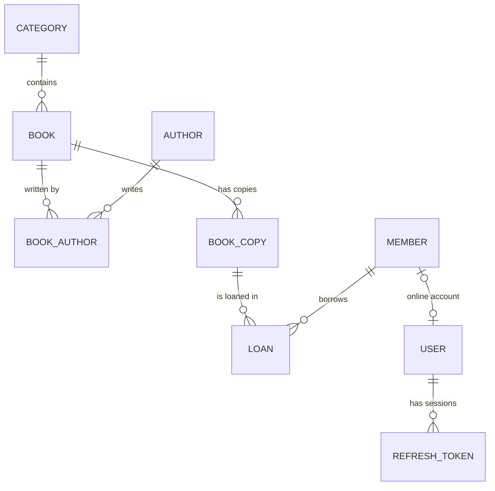

# 📚 Library Management System API


A REST API for running a library: catalog, physical copies, members, and a full circulation desk (borrowing, renewals, returns, and late fees). Built with ASP.NET Core and PostgreSQL, secured with JWT and refresh token rotation, and covered by unit and integration tests against a real database.

---

## Table of contents

- [Features](#features)
- [Tech stack](#tech-stack)
- [Architecture](#architecture)
- [Domain model](#domain-model)
- [Getting started](#getting-started)
- [Configuration](#configuration)
- [Authentication and roles](#authentication-and-roles)
- [API overview](#api-overview)
- [Business rules](#business-rules)
- [Error responses](#error-responses)
- [Testing](#testing)
- [Project structure](#project-structure)
- [Roadmap](#roadmap)

---

## Features

**Catalog**
- Categories, authors, and books (with multiple ordered authors per book)
- ISBN-10 / ISBN-13 validation with check digits and normalization
- Search (title, ISBN, author name), filtering, sorting, and pagination
- Live availability per book (`totalCopies`, `availableCopies`)

**Physical copies**
- Each book has physical copies with unique barcodes and shelf locations
- Copy status state machine: `Available`, `OnLoan`, `Maintenance`, `Lost`
- `OnLoan` can only be set or cleared by the loan system

**Members**
- Card numbers generated by a PostgreSQL sequence (`M-000123`)
- Membership expiry, renewal, suspension, and reactivation
- Search by name, email, or card number

**Circulation desk**
- Borrow by scanning a card number and a barcode
- Configurable loan period, borrowing limit, renewal limit, and daily fines
- Overdue status calculated from dates (never stored); fines frozen at return
- Protection against two desks lending the same copy at the same moment

**Security**
- JWT access tokens (short-lived) and opaque refresh tokens (long-lived)
- Refresh token rotation with reuse detection (stolen sessions are revoked)
- Roles: `Admin`, `Librarian`, `Member`, with secure-by-default authorization
- Members can only see and renew their own loans
- Password hashing (PBKDF2 via ASP.NET Core Identity's `PasswordHasher`)
- Rate limiting on authentication endpoints

**Reliability**
- Consistent RFC 9457 ProblemDetails errors with a `traceId`
- Global exception handling (database conflicts become 409, bugs become safe 500s)
- Transactions, optimistic concurrency (PostgreSQL `xmin`), and database constraints
- Soft delete with audit fields (`CreatedAt`, `UpdatedAt`, `DeletedAt`)

---

## Tech stack

| Area | Technology |
|---|---|
| Runtime | .NET 10, ASP.NET Core (Minimal APIs + one MVC controller) |
| Data | Entity Framework Core 10, Npgsql, PostgreSQL |
| Validation | FluentValidation |
| Security | JWT Bearer authentication, ASP.NET Core rate limiting |
| API docs | OpenAPI + Scalar (Development only) |
| Testing | xUnit v3, `WebApplicationFactory`, Testcontainers |

---

## Architecture

Every request follows the same path:

```
HTTP request
   │
   ▼
Validation filter        → checks the shape of the data (FluentValidation)
   │
   ▼
Endpoint / Controller    → HTTP only: calls a service, maps Result → status code
   │
   ▼
Service                  → business rules, returns Result<T> (no HTTP knowledge)
   │
   ▼
LibraryDbContext (EF)    → audit fields, soft delete, query filters
   │
   ▼
PostgreSQL               → unique/partial indexes, check constraints, sequences, xmin concurrency
```

Key design decisions:

- **Result pattern** instead of exceptions for expected errors (not found, conflict, validation). Exceptions are reserved for unexpected failures and handled globally.
- **No repository layer.** `DbContext` already acts as unit of work and `DbSet` as repository.
- **Soft delete** with global query filters; loan history ignores filters so it survives deletions.
- **Defense in depth.** Business checks in services, plus database constraints for race conditions.
- **Testable time.** Business dates use an injected `TimeProvider`.

---

## Domain model



- **Book** is a title (catalog information); **BookCopy** is one physical item.
- **Member** is a library customer; **User** is a login account (staff or member).
- **Loan** is append-only history: it is completed (returned), never edited or deleted.

---

## Getting started

### Prerequisites

- [.NET 10 SDK](https://dotnet.microsoft.com/download)
- PostgreSQL (installed locally, or running in a container)
- [Docker Desktop](https://www.docker.com/products/docker-desktop/) — only needed to run the integration tests
- The EF Core CLI tool:
  ```bash
  dotnet tool install --global dotnet-ef
  ```

### 1. Clone the repository

```bash
git clone https://github.com/YOUR-USERNAME/YOUR-REPOSITORY.git
cd YOUR-REPOSITORY
```

### 2. Set your connection string

Edit `LibraryManagementSystemAPI/appsettings.Development.json`:

```json
{
  "ConnectionStrings": {
    "LibraryDb": "Host=localhost;Port=5432;Database=librarydb;Username=postgres;Password=YOUR-PASSWORD"
  }
}
```

### 3. Store secrets with user secrets

Secrets never go in `appsettings.json`. Generate a random signing key, for example in PowerShell:

```powershell
[Convert]::ToBase64String([Security.Cryptography.RandomNumberGenerator]::GetBytes(48))
```

Then, in the `LibraryManagementSystemAPI` folder:

```bash
cd LibraryManagementSystemAPI
dotnet user-secrets set "Jwt:SigningKey" "PASTE-THE-GENERATED-KEY-HERE"
dotnet user-secrets set "BootstrapAdmin:Email" "admin@library.local"
dotnet user-secrets set "BootstrapAdmin:Password" "Choose-A-Long-Admin-Password"
```

### 4. Create the database

The repository doesn't include migration files, so create the first one from the current model, then apply it:

```bash
dotnet ef migrations add InitialCreate
dotnet ef database update
```

> If you already have an older `librarydb` from a previous version of this project, drop it first (or use a new database name) so the schema starts clean.

### 5. Run

```bash
dotnet run --launch-profile https
```

- Interactive API docs (Scalar): `https://localhost:7157/scalar/v1`
- On the first start, the console shows `Bootstrap admin admin@library.local was created.`

You can also use `LibraryManagementSystemAPI.http` in Visual Studio to log in and call the API (it reads the token from the login response automatically).

---

## Configuration

Settings are read in layers (later overrides earlier): `appsettings.json` → `appsettings.{Environment}.json` → user secrets (Development only) → environment variables → command-line arguments. In environment variables, `:` becomes `__` (for example `Jwt__SigningKey`).

| Setting | Default | Description |
|---|---|---|
| `ConnectionStrings:LibraryDb` | — | PostgreSQL connection string |
| `Jwt:SigningKey` | — | HMAC signing key, min. 32 characters (**secret**) |
| `Jwt:Issuer` / `Jwt:Audience` | see `appsettings.json` | Token issuer and audience |
| `Jwt:AccessTokenMinutes` | `15` | Access token lifetime |
| `Jwt:RefreshTokenDays` | `14` | Refresh token lifetime |
| `LibraryPolicy:MembershipDurationMonths` | `12` | Membership length (creation and renewal) |
| `LibraryPolicy:LoanPeriodDays` | `14` | Loan period and renewal extension |
| `LibraryPolicy:MaxActiveLoansPerMember` | `5` | Books a member can hold at once |
| `LibraryPolicy:MaxRenewals` | `2` | Renewals per loan |
| `LibraryPolicy:DailyFineAmount` | `5` | Fine per day late |
| `LibraryPolicy:MaxFinePerLoan` | `200` | Maximum fine per loan |
| `RateLimiting:Auth:PermitLimit` | `5` | Auth requests per window, per IP |
| `RateLimiting:Auth:WindowSeconds` | `60` | Rate limit window |
| `BootstrapAdmin:Email` / `Password` | — | Creates the first Admin if none exists (**secret**) |

Settings are validated at startup: a missing signing key or an invalid policy value stops the application with a clear error.

---

## Authentication and roles

### Getting a token

```http
POST /api/auth/login
Content-Type: application/json

{ "email": "admin@library.local", "password": "your-password" }
```

Response:

```json
{
  "accessToken": "eyJhbGciOi...",
  "accessTokenExpiresAt": "2026-11-01T09:15:00Z",
  "refreshToken": "k3J9xQ2...",
  "refreshTokenExpiresAt": "2026-11-15T09:00:00Z",
  "user": { "id": "...", "email": "admin@library.local", "role": "Admin", "memberId": null }
}
```

Send the access token on every request:

```
Authorization: Bearer <accessToken>
```

When it expires, exchange the refresh token at `POST /api/auth/refresh` for a new pair. Each refresh token works **once**; presenting a used one revokes the whole session.

### Accounts

- The first **Admin** is created at startup from the `BootstrapAdmin` settings.
- Admins create **Librarian** and **Admin** accounts with `POST /api/users`.
- Members are registered at the desk by a librarian, then activate an online account with `POST /api/auth/register-member` (card number + email on file + new password).

### Access map

| Area | Anonymous | Member | Librarian / Admin |
|---|:---:|:---:|:---:|
| Read categories, authors, books | ✅ | ✅ | ✅ |
| Create / update / delete catalog | | | ✅ |
| Book copies, members | | | ✅ |
| Borrow, return, list all loans | | | ✅ |
| View or renew one loan | | own only | ✅ |
| `/api/me`, change password, logout everywhere | | ✅ | ✅ |
| `/api/me/loans` | | ✅ | |
| Create staff accounts | | | Admin only |

Requests for another member's loan return **404**, not 403, so nothing leaks about which loans exist.

---

## API overview

> Full interactive documentation is available with Scalar in Development.

### Auth and account

| Method | Route | Access |
|---|---|---|
| `POST` | `/api/auth/login` | Anonymous (rate-limited) |
| `POST` | `/api/auth/register-member` | Anonymous (rate-limited) |
| `POST` | `/api/auth/refresh` | Anonymous (rate-limited) |
| `POST` | `/api/auth/logout` | Anonymous (needs the refresh token) |
| `GET` | `/api/me` | Logged in |
| `GET` | `/api/me/loans` | Member |
| `POST` | `/api/me/change-password` | Logged in |
| `POST` | `/api/me/logout-all` | Logged in |
| `POST` | `/api/users` | Admin |

### Catalog

| Method | Route | Access |
|---|---|---|
| `GET` | `/api/categories`, `/api/categories/{id}` | Public |
| `POST` / `PUT` / `DELETE` | `/api/categories[/{id}]` | Staff |
| `GET` | `/api/authors?search=&nationality=&page=&pageSize=` | Public |
| `GET` | `/api/authors/{id}` | Public |
| `POST` / `PUT` / `DELETE` | `/api/authors[/{id}]` | Staff |
| `GET` | `/api/books` (see query below) | Public |
| `GET` | `/api/books/{id}` | Public |
| `POST` / `PUT` / `DELETE` | `/api/books[/{id}]` | Staff |

Book query parameters: `search`, `categoryId`, `authorId`, `language`, `publishedFrom`, `publishedTo`, `availableOnly`, `sortBy` (`title`, `publicationYear`, `createdAt`), `sortDirection` (`asc`, `desc`), `page`, `pageSize` (max 100).

Paged responses look like this:

```json
{
  "items": [ ... ],
  "page": 2,
  "pageSize": 20,
  "totalCount": 734,
  "totalPages": 37,
  "hasPreviousPage": true,
  "hasNextPage": true
}
```

### Copies (staff only)

| Method | Route |
|---|---|
| `GET` / `POST` | `/api/books/{bookId}/copies` |
| `GET` / `PUT` / `DELETE` | `/api/books/{bookId}/copies/{copyId}` |
| `PUT` | `/api/books/{bookId}/copies/{copyId}/status` |

### Members (staff only)

| Method | Route |
|---|---|
| `GET` | `/api/members?search=&status=&expiredOnly=&page=&pageSize=` |
| `GET` / `PUT` / `DELETE` | `/api/members/{id}` |
| `POST` | `/api/members` |
| `POST` | `/api/members/{id}/suspend` |
| `POST` | `/api/members/{id}/reactivate` |
| `POST` | `/api/members/{id}/renew` |

### Loans

| Method | Route | Access |
|---|---|---|
| `GET` | `/api/loans?memberId=&bookId=&status=&page=&pageSize=` | Staff |
| `GET` | `/api/loans/{id}` | Staff, or the member who owns it |
| `POST` | `/api/loans` — `{ "cardNumber": "M-000001", "barcode": "LIB-000123" }` | Staff |
| `POST` | `/api/loans/{id}/return` — optional `{ "needsMaintenance": true }` | Staff |
| `POST` | `/api/loans/{id}/renew` | Staff, or the member who owns it |

Loans have no `PUT` or `DELETE`: they are history.

---

## Business rules

**Borrowing** succeeds only if all of these pass:
1. The card number belongs to an existing member.
2. The member is active and the membership hasn't expired.
3. The member has no overdue loans.
4. The member is below the borrowing limit.
5. The barcode belongs to an existing copy.
6. The copy is `Available`.

**Renewing** requires an open, not overdue loan, under the renewal limit, for a member who can still borrow. The new due date is the old due date plus the loan period.

**Returning** freezes the fine (`days late × daily fine`, capped at the maximum) and puts the copy back to `Available`, or `Maintenance` if damage is reported.

**Deleting** is protected: categories with books, authors with books, books with copies, copies on loan, and members with open loans cannot be deleted (409).

---

## Error responses

All errors use [RFC 9457 ProblemDetails](https://www.rfc-editor.org/rfc/rfc9457):

```json
{
  "type": "https://tools.ietf.org/html/rfc9110#section-15.5.10",
  "title": "Conflict",
  "status": 409,
  "detail": "This member has overdue books. They must be returned first.",
  "instance": "POST /api/loans",
  "traceId": "00-4bf92f3577b34da6a3ce929d0e0e4736-00f067aa0ba902b7-00"
}
```

Validation errors list every invalid field at once:

```json
{
  "title": "One or more validation errors occurred.",
  "status": 400,
  "errors": {
    "Isbn": [ "ISBN is not valid. Use a valid ISBN-10 or ISBN-13." ],
    "AuthorIds": [ "A book must have at least one author." ]
  }
}
```

| Status | Meaning |
|---|---|
| 400 | Invalid data in the request body or query |
| 401 | Missing, invalid, or expired token |
| 403 | Authenticated, but not allowed |
| 404 | The resource in the URL doesn't exist (or isn't yours) |
| 409 | Conflicts with the current state (duplicates, business rules, concurrent changes) |
| 429 | Too many requests (see the `Retry-After` header) |
| 500 | Unexpected error; search the server logs for the `traceId` |

---

## Testing

Docker must be running: the integration tests start a real PostgreSQL with Testcontainers and apply the migrations to it, so make sure you created the migration in [step 4](#4-create-the-database).

```bash
dotnet test
```

The suite includes:

- **Unit tests:** fines, loan status and overdue days (including boundary days), membership rules, ISBN validation, card number parsing, validators.
- **Integration tests:** the real API (`WebApplicationFactory`) against a real PostgreSQL, covering borrowing, returns with fines, overdue and expired-membership rules, validation, authorization (401/403/404), the member account flow, refresh token rotation and reuse detection, logout, and password change.
- **Concurrency test:** five simultaneous borrow requests for the same copy; exactly one succeeds and the database contains one open loan.

Time-dependent tests use a controllable `TestClock` instead of the real date.

---

## Project structure

```
├── LibraryManagementSystem.Api.slnx
├── LibraryManagementSystemAPI/
│   ├── Auth/                        # JWT, policies, current user, rate limiting, admin seeding
│   ├── Common/                      # Result, Error, helpers (ISBN, barcode, email, card, fines, paging)
│   ├── Controllers/                 # AuthorsController (MVC example)
│   ├── DataAccess/                  # DbContext and entity configurations
│   ├── Dtos/                        # requests, responses, query parameters
│   ├── Endpoints/                   # Minimal API endpoint groups
│   ├── Entities/                    # domain entities and enums
│   ├── ErrorHandling/               # global exception handlers
│   ├── Filters/                     # validation filters (Minimal API + MVC)
│   ├── Mappings/                    # entity ↔ DTO conversions
│   ├── Services/                    # business logic per feature
│   ├── Validators/                  # FluentValidation rules
│   └── Program.cs
└── LibraryManagementSystemAPI.Tests/
    ├── Unit/
    └── Integration/
        └── Infrastructure/          # factory, test clock, helpers
```

---

## Roadmap

- [ ] Production readiness: structured logging (Serilog), health checks, CORS, forwarded headers, HSTS
- [ ] Background job to clean up expired refresh tokens
- [ ] Docker image, Docker Compose, and migration bundles
- [ ] CI pipeline (GitHub Actions) running all tests on every push
- [ ] Book reservations (waiting list when no copy is available)
- [ ] Email notifications (due-date reminders, account confirmation)
- [ ] Fine payments
